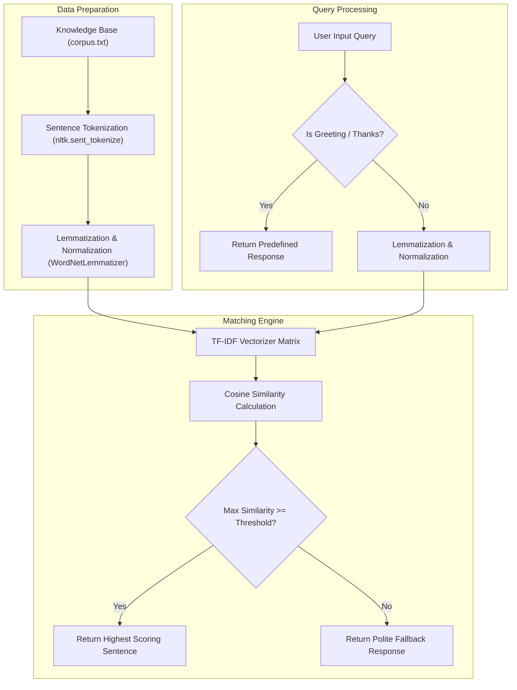

# 🤖 Live AI Chatbot for Final Year Project

A comprehensive, retrieval-based Conversational AI Chatbot built in Python using **Natural Language Processing (NLP)**, **NLTK**, **TF-IDF Vectorization**, and **Cosine Similarity**. 

This repository contains full source code, an interactive Jupyter Notebook, a command-line interface (CLI), and a modern desktop Graphical User Interface (GUI) built with Tkinter.

---

## 📑 Table of Contents
- [Project Overview](#-project-overview)
- [Key Features](#-key-features)
- [System Architecture](#-system-architecture)
- [How the NLP Pipeline Works](#-how-the-nlp-pipeline-works)
  - [1. Text Preprocessing & Tokenization](#1-text-preprocessing--tokenization)
  - [2. Lemmatization](#2-lemmatization)
  - [3. TF-IDF Vectorization](#3-tf-idf-vectorization)
  - [4. Cosine Similarity Matching](#4-cosine-similarity-matching)
- [Project Structure](#-project-structure)
- [Prerequisites & Installation](#-prerequisites--installation)
- [Execution & Usage](#-execution--usage)
  - [Option 1: Desktop GUI Application](#option-1-desktop-gui-application-recommended-for-demos)
  - [Option 2: Command-Line Interface (CLI)](#option-2-command-line-interface-cli)
  - [Option 3: Jupyter Notebook](#option-3-jupyter-notebook)
- [Sample Conversation](#-sample-conversation)
- [Extending the Knowledge Base](#-extending-the-knowledge-base)
- [Future Enhancements](#-future-enhancements)
- [License](#-license)

---

## 🌟 Project Overview

Chatbots simulate human conversation via text or voice, providing automated customer support, educational assistance, and interactive information retrieval. 

This project implements a **Retrieval-Based NLP Chatbot**:
- It ingests a curated domain knowledge base (`corpus.txt`).
- Normalizes and tokenizes both the knowledge corpus and incoming user queries.
- Extracts statistical n-gram representations via **TF-IDF (Term Frequency-Inverse Document Frequency)**.
- Compares semantic relevance using **Cosine Similarity** to select and return the best-matching response.
- Employs rule-based fallbacks for conversational greetings, thank-yous, and out-of-domain queries.

---

## ✨ Key Features

- **End-to-End NLP Pipeline**: Complete preprocessing pipeline featuring tokenization, noise removal, punctuation stripping, and morphological lemmatization.
- **Multiple Interfaces**:
  - 🖥️ **Desktop GUI**: Clean, responsive desktop chat window built with Python's Tkinter (multi-threaded to prevent UI freeze).
  - 💻 **Terminal CLI**: Lightweight interactive terminal interface.
  - 📓 **Jupyter Notebook**: Modular, documented notebook for academic presentations and code walkthroughs.
- **Dynamic Corpus Ingestion**: Change or expand the chatbot's domain knowledge simply by updating `corpus.txt` without modifying the core logic.
- **Zero External API Costs**: Operates entirely locally with `nltk` and `scikit-learn` without relying on paid proprietary APIs.

---

## 🏗️ System Architecture



---

## 🧠 How the NLP Pipeline Works

### 1. Text Preprocessing & Tokenization
Text preprocessing removes noise and formats raw textual strings for numerical vectorization:
- **Case Folding**: Converts all text to lowercase to prevent duplicate representations (e.g., `"Chatbot"` vs `"chatbot"`).
- **Punctuation Stripping**: Translates punctuation characters out using a lookup dictionary.
- **Sentence & Word Tokenization**: Splits raw documents into sentences using `nltk.sent_tokenize` and individual tokens with `nltk.word_tokenize`.

### 2. Lemmatization
Unlike stemming (which chops suffixes crudely and may produce non-words like `"comput"`), **lemmatization** uses WordNet morphological analysis to reduce inflected forms to their valid base dictionary lemma (e.g., `"playing"`, `"played"`, and `"plays"` resolve to `"play"`).

### 3. TF-IDF Vectorization
The Term Frequency-Inverse Document Frequency reflects how significant a term is to a sentence relative to the whole corpus:

$$\text{TF}(t, d) = \frac{\text{Count of term } t \text{ in document } d}{\text{Total terms in document } d}$$

$$\text{IDF}(t) = \ln\left(\frac{1 + N}{1 + \text{DF}(t)}\right) + 1$$

$$\text{TF-IDF}(t, d) = \text{TF}(t, d) \times \text{IDF}(t)$$

Where $N$ is the total number of sentences and $\text{DF}(t)$ is the number of sentences containing term $t$.

### 4. Cosine Similarity Matching
Cosine similarity measures the cosine of the angle between two multi-dimensional TF-IDF vectors:

$$\text{Cosine Similarity}(\vec{u}, \vec{v}) = \frac{\vec{u} \cdot \vec{v}}{\|\vec{u}\| \|\vec{v}\|} = \frac{\sum_{i=1}^{n} u_i v_i}{\sqrt{\sum_{i=1}^{n} u_i^2} \sqrt{\sum_{i=1}^{n} v_i^2}}$$

- A score of **1.0** indicates identical orientation in vector space.
- A score of **0.0** indicates no shared vocabulary.
- The sentence yielding the maximum similarity score above the relevance threshold (0.15) is selected as the response.

---

## 📁 Project Structure

```
Live-Chatbot-for-Final-Year-Project/
│
├── corpus.txt              # Knowledge base text covering AI, NLP, and Chatbots
├── chatbot.py              # Core NLP Chatbot engine and CLI interface
├── gui_app.py              # Tkinter Desktop GUI chat application
├── chatbot_code.ipynb      # Step-by-step Jupyter Notebook for demonstrations
├── requirements.txt        # Python library dependencies
├── LICENSE                 # MIT License
└── README.md               # Detailed project documentation and report
```

---

## ⚙️ Prerequisites & Installation

### Step 1: Clone the Repository
```bash
git clone https://github.com/CHINMAYI2005/Live-Chatbot-for-Final-Year-Project.git
cd Live-Chatbot-for-Final-Year-Project
```

### Step 2: Set Up a Python Environment (Recommended)
Python 3.8 to 3.12 is supported.
```bash
# Optional: create virtual environment
python -m venv venv
# Windows:
venv\Scripts\activate
# Linux/macOS:
source venv/bin/activate
```

### Step 3: Install Dependencies
```bash
pip install -r requirements.txt
```

---

## 🚀 Execution & Usage

### Option 1: Desktop GUI Application (Recommended for Demos)
Run the graphical interface with interactive chat bubbles:
```bash
python gui_app.py
```

### Option 2: Command-Line Interface (CLI)
Interact directly in your terminal:
```bash
python chatbot.py
```

### Option 3: Jupyter Notebook
Run the notebook step-by-step in JupyterLab or VS Code:
```bash
jupyter notebook chatbot_code.ipynb
```

---

## 💬 Sample Conversation

```text
=================================================================
   🤖 LIVE NLP CHATBOT - FINAL YEAR PROJECT
=================================================================
Chatbot initialized successfully! Knowledge corpus loaded.

You: hello
Bot: Hi there! How can I help you today?

You: What is a chatbot?
Bot: A chatbot is a software application designed to simulate human conversation through text or voice interactions.

You: What is TF-IDF?
Bot: Tf-idf stands for term frequency-inverse document frequency.

You: Explain cosine similarity.
Bot: Cosine similarity is a metric used to measure how similar two vectors are, irrespective of their size.

You: Tell me about deep learning
Bot: Deep learning is a subset of machine learning based on artificial neural networks with representation learning.

You: What is the weather tomorrow?
Bot: I am sorry, but I do not have sufficient information in my knowledge base to answer that. Could you please rephrase?

You: thank you so much
Bot: You're welcome! Glad I could help.

You: bye
Bot: Goodbye! Have a wonderful day ahead!
```

---

## 📚 Extending the Knowledge Base

To train the chatbot on any new domain (such as College Campus FAQs, Healthcare, Banking, or Technical Documentation):
1. Open [`corpus.txt`](file:///corpus.txt).
2. Add your custom paragraphs and information.
3. Save the file.
4. Restart the bot (`python gui_app.py` or `python chatbot.py`). The bot automatically builds a new TF-IDF vocabulary matrix on startup!

---

## 🔮 Future Enhancements

- **Transformer / LLM Integration**: Incorporate Sentence-BERT (`sentence-transformers`) for deep semantic embeddings.
- **Voice Recognition & Speech Output**: Integrate `speech_recognition` and `pyttsx3` for two-way spoken conversation.
- **Web Interface**: Deploy as a responsive web app using Streamlit or FastAPI + React.
- **Conversation History Logging**: Store user logs in SQLite / MongoDB for analytics and ongoing bot improvement.

---

## 📄 License

This project is licensed under the [MIT License](LICENSE).
